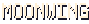

<p align="center">
  
</p>

# Moonwing for Compás

A tap-to-fly arcade game for the [Compás](https://compasplayer.org/apps.html)
external-app launcher, tested on the HiBy R1. Fly through the gates, beat your
best score, and try the different bird designs. The game is silent.

## Install

1. Unzip `moonwing-compas.zip`.
2. Copy the `moonwing` folder into `.apps` at the root of the microSD card.
   Create `.apps` if it does not exist.
3. On the player, open **More → External Apps → Moonwing** and approve the launch.

The installed folder contains the executable, `app.json`, and `icon.png`.
Artwork is embedded in the executable; no separate assets are needed.
Your best completed score is saved to `.apps-data/moonwing/best-score.txt`.

## Controls

| Action | Control |
| --- | --- |
| Start or retry | Tap **Fly** |
| Flap | Tap the screen, press Play/Pause, or press Volume Up |
| Exit to Compás | Tap **×** in the top-right corner or press Power |

## Build

Requires **Go 1.21 or newer**, **Make**, and **zip**. Run commands from the
repository root.

```sh
make package
```

This builds a static Linux MIPS32 little-endian executable with software
floating point, ready for Compás on the HiBy R1.

| Command | Output |
| --- | --- |
| `make` | Install folder at `dist/moonwing/` |
| `make package` | Install folder and rebuildable source in `dist/moonwing-compas.zip` |
| `make test` | Rendering, touch, timing, and flight-physics checks |

The archive contains `moonwing/` for installation and `moonwing-source/` for
rebuilding. Run the same commands inside `moonwing-source/` to rebuild it.

## Source layout

```text
src/
  *.go          Game, rendering, device input, and tests
  app.json      Compás manifest and in-game version
  artwork/      Embedded PNG sprites and backgrounds
go.mod          Go module
Makefile        Build, package, and test targets
icon.png        Launcher icon
icon-prompt.txt Launcher icon design notes
```

The game follows the display's native refresh cadence, with one simulation
update per presented frame. Bird rotation stays enabled. Long stalls pause
an active run. A text-only loading screen appears before artwork decoding
and switches to the menu as soon as startup finishes.

## Updating artwork

Replace PNGs in [`src/artwork/`](src/artwork/) using the existing filenames,
capitalization, and canvas sizes, then run `make package`. Transparent pixels
are supported. Install the rebuilt app folder to preview changes on the player.

- Keep each bird centered within its three animation frames.
- Leave room for live numbers below **SCORE** and **BEST** in `score-board.png`.
- Backgrounds are cropped above the ground to fit the screen. Their bottom
  56 rows are covered by the separate ground sprite.
- `menu.png`, `sound-on.png`, and `sound-off.png` are reserved artwork.

Replace the root `icon.png` to change the launcher icon; keep it square.
Edit [`src/app.json`](src/app.json) to change the app version. The menu reads
its version from this same manifest.
